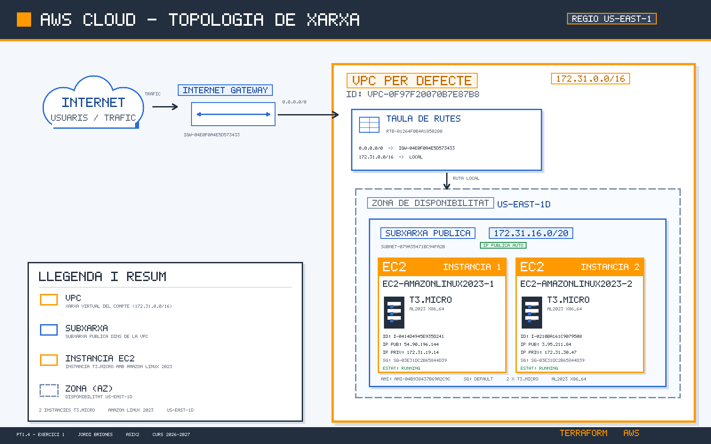

# Pt1.4 — Exercici 1: Primeres instàncies EC2 amb Terraform

## Descripció del projecte

Aquest projecte és una introducció a la **Infraestructura com a Codi (IaC)** amb
Terraform. L'objectiu és desplegar de forma automàtica **2 instàncies EC2** a AWS
amb les característiques següents:

- **Tipus d'instància:** `t3.micro`
- **Sistema operatiu:** Amazon Linux 2023 (`al2023-ami-2023.*-x86_64`)
- **Regió AWS:** `us-east-1` (N. Virginia)
- **Nombre d'instàncies:** 2
- **Etiquetes:** `EC2-AmazonLinux2023-1` i `EC2-AmazonLinux2023-2`

Les instàncies es despleguen a la **VPC per defecte** del compte d'AWS, dins
d'una subxarxa pública, i obtenen una IP pública automàticament.

## Objectius de l'exercici

- Entendre el cicle de vida bàsic de Terraform: `init`, `plan`, `apply` i `destroy`.
- Utilitzar un *data source* per obtenir dinàmicament l'AMI més recent d'Amazon Linux 2023.
- Crear diversos recursos idèntics amb `count`.
- Documentar la infraestructura i la seva topologia de xarxa.

## Estructura del projecte

```text
practiquescloud/
└── pt1-4-ex1/
    ├── assets/
    │   └── topologia.png
    ├── README.md
    └── main.tf
```

## Topologia de xarxa



El diagrama mostra el flux complet des d'Internet fins a les dues instàncies:

```text
Internet
   │
   ▼
Internet Gateway (igw-04e0f0a4e5d573433)
   │  0.0.0.0/0
   ▼
Taula de rutes (rtb-01264f0b4a1850280)
   │  ruta local 172.31.0.0/16
   ▼
VPC per defecte (172.31.0.0/16)
   └── Zona de disponibilitat us-east-1d
        └── Subxarxa pública (172.31.16.0/20)
             ├── EC2-AmazonLinux2023-1
             └── EC2-AmazonLinux2023-2
```

### Recursos representats

| Recurs | Valor |
| --- | --- |
| VPC | `vpc-0f97f20070b7e87b8` — `172.31.0.0/16` (per defecte) |
| Zona de disponibilitat | `us-east-1d` |
| Subxarxa pública | `subnet-079a35471bc94fa2b` — `172.31.16.0/20` |
| Internet Gateway | `igw-04e0f0a4e5d573433` |
| Taula de rutes | `rtb-01264f0b4a1850280` |
| Security Group | `sg-03e31dc2b65844d39` (`default`) |
| AMI | `ami-04b938437b69a2c9c` (Amazon Linux 2023 x86_64) |

### Detalls de connectivitat

- Les instàncies tenen **IP pública assignada automàticament** per la subxarxa.
- La taula de rutes envia el trànsit `0.0.0.0/0` cap a l'**Internet Gateway** i el
  trànsit intern `172.31.0.0/16` per la ruta `local`.
- El **Security Group `default`** no obre ports SSH/HTTP des d'Internet; només
  permet el trànsit entre instàncies del mateix grup. En aquest exercici no s'ha
  definit cap *key pair* ni cap regla d'entrada addicional.
- Les dues instàncies comparteixen la mateixa subxarxa i la mateixa zona de
  disponibilitat (`us-east-1d`).

> **Nota:** el diagrama és una representació gràfica del desplegament real. Es pot
> substituir per un diagrama fet amb **draw.io** exportat a PNG mantenint el mateix
> nom de fitxer (`assets/topologia.png`).

## Requisits previs

Abans d'executar el projecte cal tenir:

1. **Terraform** instal·lat (versió 1.5 o superior):

   ```bash
   terraform version
   ```

2. **AWS CLI** instal·lada i configurada amb un usuari o rol que tingui permisos
   per crear i destruir instàncies EC2:

   ```bash
   aws configure
   aws sts get-caller-identity
   ```

3. Les credencials d'AWS disponibles al perfil per defecte
   (`~/.aws/credentials`) o mitjançant les variables d'entorn
   `AWS_ACCESS_KEY_ID`, `AWS_SECRET_ACCESS_KEY` i, si escau, `AWS_SESSION_TOKEN`.

## Descripció del codi Terraform (`main.tf`)

| Bloc | Funció |
| --- | --- |
| `terraform` | Defineix la versió mínima de Terraform i el proveïdor `hashicorp/aws`. |
| `provider "aws"` | Configura la regió `us-east-1`. |
| `data "aws_ami"` | Cerca dinàmicament l'AMI més recent d'Amazon Linux 2023 per a arquitectura x86_64. |
| `resource "aws_instance" "ec2"` | Crea 2 instàncies `t3.micro` amb `count = 2` i les etiquetes `EC2-AmazonLinux2023-1` i `EC2-AmazonLinux2023-2`. |
| `output` | Mostra els IDs, noms, IPs públiques i privades de les instàncies, i l'AMI utilitzada. |

El filtre de l'AMI és:

```hcl
filter {
  name   = "name"
  values = ["al2023-ami-2023.*-x86_64"]
}
```

D'aquesta manera no cal codificar cap ID d'AMI fix, i el desplegament agafa
sempre la versió més recent publicada per Amazon.

## Execució pas a pas

Tots els comandaments s'han d'executar dins del directori `pt1-4-ex1`.

### 1. Entrar al directori de l'exercici

Si el repositori ja el tens clonat:

```bash
git clone https://github.com/<usuari>/practiquescloud.git
cd practiquescloud/pt1-4-ex1
```

Si ja hi ets dins del repositori local:

```bash
cd practiquescloud/pt1-4-ex1
```

### 2. Inicialitzar Terraform

```bash
terraform init
```

Aquest comandament:

- Descarrega el proveïdor d'AWS.
- Crea el directori `.terraform/`.
- Genera o actualitza el fitxer `.terraform.lock.hcl`.

### 3. Formatar i validar el codi (recomanat)

```bash
terraform fmt
terraform validate
```

`terraform fmt` aplica el format estàndard de HCL i `terraform validate` comprova
que la sintaxi i la configuració siguin correctes.

### 4. Revisar el pla d'execució

```bash
terraform plan
```

Terraform mostra un resum dels recursos que crearà. En aquest cas hauria
d'indicar:

```text
Plan: 2 to add, 0 to change, 0 to destroy.
```

Si es vol guardar el pla per aplicar-lo exactament després:

```bash
terraform plan -out=tfplan
terraform apply tfplan
```

### 5. Aplicar la infraestructura

```bash
terraform apply -auto-approve
```

`-auto-approve` evita la confirmació interactiva. Quan acabi, Terraform mostrarà
els *outputs* amb els IDs i les IPs de les instàncies.

També es pot executar sense `-auto-approve` i confirmar escrivint `yes`:

```bash
terraform apply
```

### 6. Consultar els resultats

```bash
terraform output
```

Per veure un output concret:

```bash
terraform output instance_ids
terraform output instance_public_ips
```

També es pot comprovar des de l'AWS CLI:

```bash
aws ec2 describe-instances \
  --region us-east-1 \
  --filters "Name=tag:Name,Values=EC2-AmazonLinux2023-*" \
  --query "Reservations[].Instances[].{ID:InstanceId,Nom:Tags[?Key=='Name']|[0].Value,IP:PublicIpAddress,Estat:State.Name}" \
  --output table
```

### 7. Destruir la infraestructura

Quan ja no calguin les instàncies, cal eliminar els recursos per evitar costos:

```bash
terraform destroy -auto-approve
```

Terraform demanarà confirmació si no s'utilitza `-auto-approve`:

```bash
terraform destroy
```

En acabar, verifica que no queden instàncies amb l'etiqueta de l'exercici:

```bash
aws ec2 describe-instances \
  --region us-east-1 \
  --filters "Name=tag:Name,Values=EC2-AmazonLinux2023-*" \
  --query "Reservations[].Instances[].State.Name"
```

## Outputs de Terraform

| Output | Descripció |
| --- | --- |
| `instance_ids` | Llista amb els IDs de les dues instàncies EC2. |
| `instance_names` | Llista amb les etiquetes `Name` de les instàncies. |
| `instance_public_ips` | IPs públiques assignades. |
| `instance_private_ips` | IPs privades dins de la VPC. |
| `ami_id` | ID de l'AMI d'Amazon Linux 2023 utilitzada. |

## Resultat del desplegament

El desplegament s'ha executat correctament el **26/10/2026** a la regió
`us-east-1`. Les dues instàncies han quedat en estat `running`:

| Nom | ID d'instància | Tipus | Zona | IP pública | IP privada |
| --- | --- | --- | --- | --- | --- |
| `EC2-AmazonLinux2023-1` | `i-0414d4945e935d241` | `t3.micro` | `us-east-1d` | `54.90.196.144` | `172.31.19.14` |
| `EC2-AmazonLinux2023-2` | `i-0210ba161c9079508` | `t3.micro` | `us-east-1d` | `3.95.211.84` | `172.31.30.47` |

- **AMI utilitzada:** `ami-04b938437b69a2c9c` (Amazon Linux 2023 x86_64)
- **Subxarxa:** `subnet-079a35471bc94fa2b` (subxarxa pública de la VPC per defecte)

Sortida de `terraform output`:

```text
ami_id = "ami-04b938437b69a2c9c"
instance_ids = [
  "i-0414d4945e935d241",
  "i-0210ba161c9079508",
]
instance_names = [
  "EC2-AmazonLinux2023-1",
  "EC2-AmazonLinux2023-2",
]
instance_private_ips = [
  "172.31.19.14",
  "172.31.30.47",
]
instance_public_ips = [
  "54.90.196.144",
  "3.95.211.84",
]
```

> Els IDs reals del desplegament també es poden consultar a la sortida de
> `terraform apply` i al fitxer d'estat `terraform.tfstate`. Aquest fitxer no es
> puja al repositori per seguretat. Si es torna a executar `terraform destroy` i
> `terraform apply`, els IDs i les IPs canviaran.

## Costos i neteja

Les instàncies `t3.micro` poden estar cobertes pel pla gratuït d'AWS segons el
compte i la regió, però és responsabilitat de l'alumne revisar-ho. Per evitar
càrrecs inesperats:

1. Executa `terraform destroy -auto-approve` en acabar la pràctica.
2. Comprova al panell d'EC2 que les instàncies han estat terminades.
3. No pugis mai `terraform.tfstate`, claus `.pem` ni credencials al repositori.

## Resolució de problemes

- **Error d'autenticació:** comprova que `aws sts get-caller-identity` funciona i
  que les credencials no han caducat.
- **No es troba cap AMI:** revisa que la regió sigui `us-east-1` i que el filtre
  `al2023-ami-2023.*-x86_64` continuï sent vàlid.
- **No hi ha VPC per defecte:** crea'n una des de la consola d'AWS o adapta el
  codi per indicar una `subnet_id` existent.
- **Límit d'instàncies:** sol·licita un augment de quota a AWS si el compte no
  permet crear dues instàncies `t3.micro`.

## Autor

**Jordi Briones** — ASIX2  
Mòdul OPT: Cloud Computing — Curs 2026-2027  
INS Provençana
