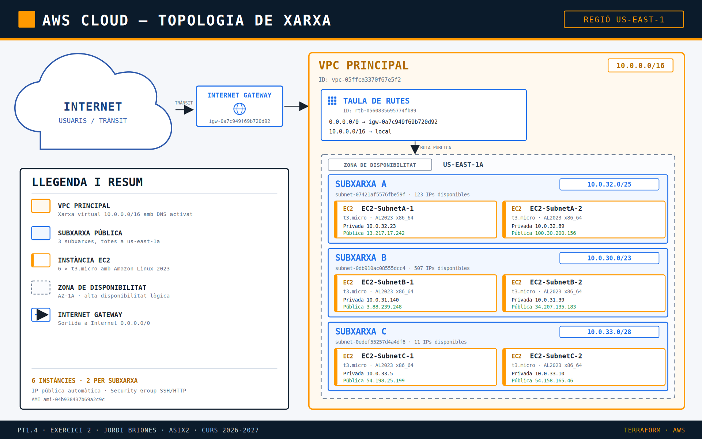
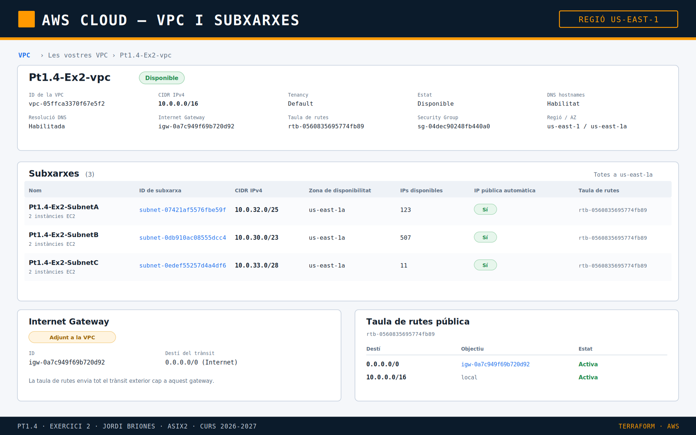
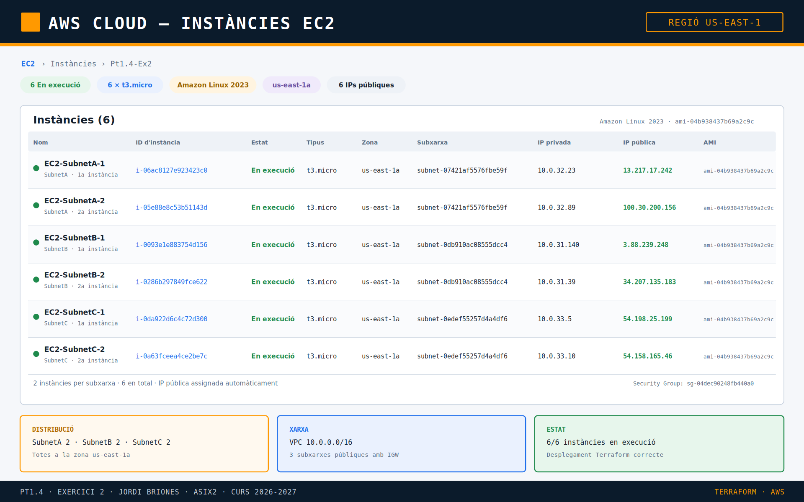

# Pt1.4 — Exercici 2: VPC, subxarxes i 6 instàncies EC2 amb Terraform

## Descripció del projecte

Aquest projecte desplega de forma **totalment automatitzada amb Terraform** la
infraestructura de xarxa dissenyada a la part A de la pràctica i les **6
instàncies EC2** que a la part B s'havien creat manualment des de la consola
d'AWS.

L'objectiu és demostrar que es pot reproduir exactament el mateix entorn amb
**Infraestructura com a Codi (IaC)**, de manera versionada, repetible i sense
dependre de clics a la interfície gràfica.

### Resum de la infraestructura

| Element | Configuració |
| --- | --- |
| Regió AWS | `us-east-1` (N. Virginia) |
| VPC | `10.0.0.0/16` (personalitzada) |
| Subxarxes | 3 subxarxes públiques a `us-east-1a` |
| Zona de disponibilitat | `us-east-1a` (AZ-1A) |
| Instàncies | 6 × `t3.micro` (2 per subxarxa) |
| Sistema operatiu | Amazon Linux 2023 (x86_64) |
| IP pública | Assignada automàticament a cada instància |
| Internet Gateway | 1, amb taula de rutes `0.0.0.0/0` |
| Security Group | SSH (22/tcp) i HTTP (80/tcp) |

## Objectius de l'exercici

- Dissenyar i desplegar una **VPC personalitzada** amb 3 subxarxes.
- Calcular correctament l'adreçament IP de cada subxarxa segons l'enunciat.
- Desplegar **2 instàncies EC2 a cada subxarxa** (6 en total) amb Amazon Linux 2023.
- Utilitzar **variables** i **locals** per evitar valors *hardcoded* i fer el codi
  modular i reutilitzable.
- Documentar tot el procés i comparar el desplegament manual (Part B) amb el
  desplegament automatitzat (Part C).
- Publicar el codi i la documentació en un repositori públic de GitHub.

## Estructura del projecte

```text
practiquescloud/
└── pt1-4-ex2/
    ├── assets/
    │   ├── topologia.png
    │   ├── vpc_subnets.png
    │   └── ec2_instances.png
    ├── README.md
    ├── main.tf
    ├── variables.tf
    └── outputs.tf
```

> `main.tf` conté els recursos, `variables.tf` els paràmetres configurables i
> `outputs.tf` els valors que es mostren després del desplegament. El fitxer
> `terraform.tfstate` **no es puja al repositori** (està inclòs al `.gitignore`).

## Disseny de la xarxa

### VPC i subxarxes

Totes les subxarxes es troben dins de la mateixa VPC i a la mateixa zona de
disponibilitat, tal com demana l'enunciat:

| Subxarxa | CIDR | Rang d'adreces | Adreces totals | IPs útils (AWS) | AZ | Instàncies |
| --- | --- | --- | --- | --- | --- | --- |
| `SubnetA` | `10.0.32.0/25` | `10.0.32.0` – `10.0.32.127` | 128 | 123 | `us-east-1a` | 2 |
| `SubnetB` | `10.0.30.0/23` | `10.0.30.0` – `10.0.31.255` | 512 | 507 | `us-east-1a` | 2 |
| `SubnetC` | `10.0.33.0/28` | `10.0.33.0` – `10.0.33.15` | 16 | 11 | `us-east-1a` | 2 |
| **VPC** | **`10.0.0.0/16`** | `10.0.0.0` – `10.0.255.255` | 65.536 | 65.531 | — | **6** |

AWS reserva **5 adreces** a cada subxarxa: la primera (adreça de xarxa), la
segona (router de la VPC), la tercera (DNS), la quarta (futurs usos) i l'última
(broadcast). Per això una `/28` només permet 11 IPs útils.

Les tres subxarxes són **públiques**: tenen `map_public_ip_on_launch = true` i
estan associades a una taula de rutes amb sortida `0.0.0.0/0` cap a l'Internet
Gateway.

### Topologia de xarxa



```text
Internet
   │
   ▼
Internet Gateway (igw-0a7c949f69b720d92)
   │  0.0.0.0/0
   ▼
Taula de rutes pública (rtb-0560835695774fb89)
   │  ruta local 10.0.0.0/16
   ▼
VPC principal (10.0.0.0/16)
   └── Zona de disponibilitat us-east-1a
        ├── SubnetA (10.0.32.0/25)
        │    ├── EC2-SubnetA-1
        │    └── EC2-SubnetA-2
        ├── SubnetB (10.0.30.0/23)
        │    ├── EC2-SubnetB-1
        │    └── EC2-SubnetB-2
        └── SubnetC (10.0.33.0/28)
             ├── EC2-SubnetC-1
             └── EC2-SubnetC-2
```

### Recursos desplegats

| Recurs | ID | Detalls |
| --- | --- | --- |
| VPC | `vpc-05ffca3370f67e5f2` | `10.0.0.0/16`, DNS activat |
| SubnetA | `subnet-07421af5576fbe59f` | `10.0.32.0/25`, `us-east-1a` |
| SubnetB | `subnet-0db910ac08555dcc4` | `10.0.30.0/23`, `us-east-1a` |
| SubnetC | `subnet-0edef55257d4a4df6` | `10.0.33.0/28`, `us-east-1a` |
| Internet Gateway | `igw-0a7c949f69b720d92` | Adjunt a la VPC |
| Taula de rutes | `rtb-0560835695774fb89` | `0.0.0.0/0` → IGW, `10.0.0.0/16` → local |
| Security Group | `sg-04dec90248fb440a0` | SSH 22/tcp i HTTP 80/tcp |
| AMI | `ami-04b938437b69a2c9c` | Amazon Linux 2023 x86_64 |

## Descripció del codi Terraform

### `main.tf`

| Bloc | Funció |
| --- | --- |
| `terraform` | Versió mínima de Terraform (`>= 1.5.0`) i proveïdor `hashicorp/aws ~> 6.0`. |
| `provider "aws"` | Regió `us-east-1` i `default_tags` (`Project`, `ManagedBy`) per a tots els recursos. |
| `data "aws_ami"` | Obté dinàmicament l'AMI més recent d'Amazon Linux 2023 x86_64. |
| `aws_vpc.main` | Crea la VPC `10.0.0.0/16` amb DNS *hostnames* i resolució activats. |
| `aws_internet_gateway.main` | Internet Gateway de la VPC. |
| `aws_subnet.public` | Crea les 3 subxarxes amb `for_each` a partir del mapa `var.subnets`. |
| `aws_route_table.public` | Taula de rutes amb `0.0.0.0/0` cap a l'IGW. |
| `aws_route_table_association.public` | Associa la taula de rutes a les 3 subxarxes. |
| `aws_security_group.instances` | Permet SSH des de `var.ssh_cidr` i HTTP des de qualsevol origen. |
| `locals.instances` | Genera dinàmicament les 6 combinacions subxarxa + índex. |
| `aws_instance.ec2` | Crea les 6 instàncies amb `for_each`, cadascuna a la seva subxarxa. |

El càlcul de les instàncies es fa amb `for_each` sobre el mapa de subxarxes:

```hcl
locals {
  instances = merge([
    for subnet_key, subnet in var.subnets : {
      for index in range(1, var.instances_per_subnet + 1) :
      "${subnet_key}-${index}" => {
        subnet_key = subnet_key
        subnet     = subnet.name
        subnet_az  = subnet.availability_zone
        index      = index
      }
    }
  ]...)
}
```

Això permet canviar el nombre d'instàncies per subxarxa amb una sola variable
(`instances_per_subnet`) sense tocar cap recurs.

### `variables.tf`

| Variable | Tipus | Valor per defecte | Descripció |
| --- | --- | --- | --- |
| `aws_region` | `string` | `us-east-1` | Regió on es desplega tot. |
| `project_name` | `string` | `Pt1.4-Ex2` | Prefix de les etiquetes. |
| `vpc_cidr` | `string` | `10.0.0.0/16` | CIDR de la VPC. |
| `subnets` | `map(object)` | 3 subxarxes | Nom, CIDR i AZ de cada subxarxa. |
| `instance_type` | `string` | `t3.micro` | Tipus d'instància EC2. |
| `instances_per_subnet` | `number` | `2` | Instàncies per subxarxa (total 6). |
| `ssh_cidr` | `string` | `0.0.0.0/0` | Rang autoritzat a SSH. |

### `outputs.tf`

| Output | Descripció |
| --- | --- |
| `vpc_id`, `vpc_cidr` | Identificador i CIDR de la VPC. |
| `subnet_ids`, `subnet_cidrs` | IDs i CIDRs de les 3 subxarxes. |
| `route_table_id`, `internet_gateway_id` | IDs de la taula de rutes i de l'IGW. |
| `security_group_id` | ID del Security Group. |
| `instance_ids` | IDs de les 6 instàncies. |
| `instance_names` | Etiquetes `Name` de les instàncies. |
| `instance_public_ips`, `instance_private_ips` | IPs públiques i privades. |
| `instance_subnets` | Subxarxa on ha quedat cada instància. |
| `ami_id` | AMI d'Amazon Linux 2023 utilitzada. |

## Requisits previs

1. **Terraform** 1.5 o superior:

   ```bash
   terraform version
   ```

2. **AWS CLI** configurada amb un usuari o rol amb permisos per crear VPC,
   subxarxes, Internet Gateway, taules de rutes, Security Groups i instàncies
   EC2:

   ```bash
   aws configure
   aws sts get-caller-identity
   ```

3. Credencials al perfil per defecte (`~/.aws/credentials`) o a les variables
   d'entorn `AWS_ACCESS_KEY_ID`, `AWS_SECRET_ACCESS_KEY` i, si escau,
   `AWS_SESSION_TOKEN`.

## Execució pas a pas

Tots els comandaments s'executen dins del directori `pt1-4-ex2`.

### 1. Entrar al directori

```bash
git clone https://github.com/jordibriones2005-commits/practiquescloud.git
cd practiquescloud/pt1-4-ex2
```

### 2. Inicialitzar Terraform

```bash
terraform init
```

Descarrega el proveïdor d'AWS, crea `.terraform/` i genera
`.terraform.lock.hcl`.

### 3. Formatar i validar

```bash
terraform fmt
terraform validate
```

### 4. Revisar el pla

```bash
terraform plan
```

El resum esperat és:

```text
Plan: 16 to add, 0 to change, 0 to destroy.
```

Els 16 recursos són: 1 VPC, 3 subxarxes, 1 Internet Gateway, 1 taula de rutes,
3 associacions de taula de rutes, 1 Security Group i 6 instàncies EC2.

### 5. Aplicar la infraestructura

```bash
terraform apply -auto-approve
```

En acabar, Terraform mostra els *outputs* amb tots els IDs, IPs i CIDRs.

### 6. Consultar els resultats

```bash
terraform output
terraform output instance_public_ips
terraform output instance_private_ips
```

També es pot comprovar directament amb l'AWS CLI:

```bash
aws ec2 describe-instances \
  --region us-east-1 \
  --filters "Name=tag:Project,Values=Pt1.4-Ex2" \
  --query "Reservations[].Instances[].{Nom:Tags[?Key=='Name']|[0].Value,ID:InstanceId,Estat:State.Name,IP:PublicIpAddress}" \
  --output table
```

### 7. Destruir la infraestructura

```bash
terraform destroy -auto-approve
```

> **Important:** les instàncies `t3.micro` i la VPC generen costos mentre estan
> en execució. Cal executar `terraform destroy` quan s'acabi la pràctica.

## Resultat del desplegament

El desplegament es va executar correctament el **28/10/2026** a `us-east-1`.
Les 6 instàncies van quedar en estat `running`, totes a `us-east-1a`:

| Nom | ID d'instància | Estat | Tipus | Subxarxa | IP privada | IP pública |
| --- | --- | --- | --- | --- | --- | --- |
| `EC2-SubnetA-1` | `i-06ac8127e923423c0` | running | `t3.micro` | `SubnetA` | `10.0.32.23` | `13.217.17.242` |
| `EC2-SubnetA-2` | `i-05e88e8c53b51143d` | running | `t3.micro` | `SubnetA` | `10.0.32.89` | `100.30.200.156` |
| `EC2-SubnetB-1` | `i-0093e1e883754d156` | running | `t3.micro` | `SubnetB` | `10.0.31.140` | `3.88.239.248` |
| `EC2-SubnetB-2` | `i-0286b297849fce622` | running | `t3.micro` | `SubnetB` | `10.0.31.39` | `34.207.135.183` |
| `EC2-SubnetC-1` | `i-0da922d6c4c72d300` | running | `t3.micro` | `SubnetC` | `10.0.33.5` | `54.198.25.199` |
| `EC2-SubnetC-2` | `i-0a63fceea4ce2be7c` | running | `t3.micro` | `SubnetC` | `10.0.33.10` | `54.158.165.46` |

- **AMI:** `ami-04b938437b69a2c9c` (Amazon Linux 2023 x86_64)
- **VPC:** `vpc-05ffca3370f67e5f2` (`10.0.0.0/16`)
- **Security Group:** `sg-04dec90248fb440a0`

### Captures del desplegament

VPC, subxarxes, Internet Gateway i taula de rutes:



Llistat de les 6 instàncies EC2 en execució:



Sortida de `terraform output`:

```text
ami_id = "ami-04b938437b69a2c9c"
instance_ids = {
  "subnet-a-1" = "i-06ac8127e923423c0"
  "subnet-a-2" = "i-05e88e8c53b51143d"
  "subnet-b-1" = "i-0093e1e883754d156"
  "subnet-b-2" = "i-0286b297849fce622"
  "subnet-c-1" = "i-0da922d6c4c72d300"
  "subnet-c-2" = "i-0a63fceea4ce2be7c"
}
instance_private_ips = {
  "subnet-a-1" = "10.0.32.23"
  "subnet-a-2" = "10.0.32.89"
  "subnet-b-1" = "10.0.31.140"
  "subnet-b-2" = "10.0.31.39"
  "subnet-c-1" = "10.0.33.5"
  "subnet-c-2" = "10.0.33.10"
}
instance_public_ips = {
  "subnet-a-1" = "13.217.17.242"
  "subnet-a-2" = "100.30.200.156"
  "subnet-b-1" = "3.88.239.248"
  "subnet-b-2" = "34.207.135.183"
  "subnet-c-1" = "54.198.25.199"
  "subnet-c-2" = "54.158.165.46"
}
internet_gateway_id = "igw-0a7c949f69b720d92"
route_table_id = "rtb-0560835695774fb89"
security_group_id = "sg-04dec90248fb440a0"
subnet_ids = {
  "subnet-a" = "subnet-07421af5576fbe59f"
  "subnet-b" = "subnet-0db910ac08555dcc4"
  "subnet-c" = "subnet-0edef55257d4a4df6"
}
vpc_id = "vpc-05ffca3370f67e5f2"
```

> Els IDs i les IPs poden canviar si es torna a executar `terraform destroy` i
> `terraform apply`. El fitxer `terraform.tfstate` no es puja al repositori.

## Comparació: desplegament manual vs. Terraform

| Aspecte | Part B (consola AWS) | Part C (Terraform) |
| --- | --- | --- |
| Temps de creació | Llarg: cal crear cada recurs a mà | Un sol `terraform apply` |
| Errors humans | Fàcil equivocar-se de CIDR o d'AZ | Valors validats i versionats |
| Repetibilitat | Cal repetir tots els clics | `apply` idèntic cada vegada |
| Documentació | Captures de pantalla | Codi + README + `terraform plan` |
| Eliminació | Esborrar recurs per recurs | `terraform destroy` |
| Control de canvis | No hi ha historial | Git + `terraform plan` |

## Verificació de la xarxa

Comprovar les subxarxes i les seves associacions:

```bash
aws ec2 describe-subnets \
  --region us-east-1 \
  --filters "Name=vpc-id,Values=vpc-05ffca3370f67e5f2" \
  --query "Subnets[].{CIDR:CidrBlock,AZ:AvailabilityZone,ID:SubnetId,IPs:AvailableIpAddressCount}" \
  --output table
```

Comprovar que la taula de rutes envia el trànsit a l'IGW:

```bash
aws ec2 describe-route-tables \
  --region us-east-1 \
  --route-table-ids rtb-0560835695774fb89 \
  --output table
```

Comprovar que les 6 instàncies estan en execució:

```bash
aws ec2 describe-instances \
  --region us-east-1 \
  --filters "Name=tag:Project,Values=Pt1.4-Ex2" \
  --query "Reservations[].Instances[].[Tags[?Key=='Name']|[0].Value,State.Name,PrivateIpAddress,PublicIpAddress]" \
  --output table
```

## Costos i neteja

- Les 6 instàncies `t3.micro` poden estar cobertes pel pla gratuït segons el
  compte, però la VPC, les IPs públiques i el trànsit poden generar costos.
- Per eliminar tota la infraestructura:

  ```bash
  terraform destroy -auto-approve
  ```

- Comprova a la consola d'EC2 que no queda cap instància amb l'etiqueta
  `Project = Pt1.4-Ex2`.
- No pugis mai `terraform.tfstate`, claus `.pem` ni credencials al repositori.

## Resolució de problemes

- **Error d'autenticació:** comprova `aws sts get-caller-identity` i que les
  credencials no hagin caducat (AWS Academy les caduca al cap d'unes hores).
- **`InvalidSubnet.Conflict`:** algun CIDR se solapa amb una altra subxarxa o
  amb la VPC per defecte. Revisa el mapa `var.subnets`.
- **`Unsupported` a `us-east-1a`:** comprova que la zona existeix al compte i
  que la regió és `us-east-1`.
- **Límit d'instàncies:** si el compte no permet 6 `t3.micro`, demana un augment
  de quota o redueix `instances_per_subnet`.
- **No es troba l'AMI:** el filtre `al2023-ami-2023.*-x86_64` pot canviar amb el
  temps; actualitza'l si Amazon publica un format nou.

## Autor

**Jordi Briones** — ASIX2  
Mòdul OPT: Cloud Computing — Curs 2026-2027  
INS Provençana
